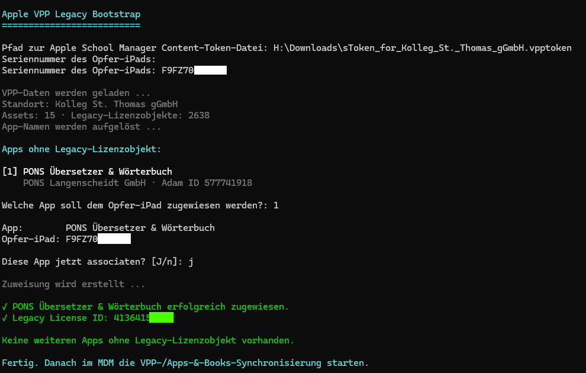

# Apple VPP Legacy Bootstrap

Kleines PowerShell-Tool als Workaround für ein aktuelles Problem mit kostenlosen Apps aus dem Apple School Manager.

Das Problem ist unter anderem bei IServ relevant: Neu hinzugefügte kostenlose Apps können im Apple School Manager vorhanden sein, aber im MDM trotzdem nicht erscheinen.

## Problem

Apple hat die Lizenzverwaltung für kostenlose Apps geändert.

Früher wurden auch kostenlose Apps mit einer festen Anzahl an Lizenzen hinterlegt. Viele ältere MDM-Systeme erkennen eine App deshalb erst dann, wenn mindestens eine klassische VPP-Lizenz vorhanden ist.

Seit der Umstellung behandelt Apple kostenlose Apps dagegen als **unbegrenzt verfügbar**. Neu hinzugefügte Apps besitzen zunächst keine einzelne klassische Lizenz mehr.

Das kann dazu führen, dass:

- die App im Apple School Manager vorhanden ist,
- sie dort auch korrekt als verfügbar gilt,
- sie im MDM aber trotzdem nicht erscheint.

## Lösung

Dieses Skript erzeugt für eine ausgewählte App einmalig wieder eine solche klassische Lizenz.

Dafür wird die App einem vorhandenen Test-iPad zugeordnet. Apple erstellt dadurch ein Legacy-Lizenzobjekt, das ältere MDM-Systeme erkennen können.

Die App bleibt trotzdem weiterhin kostenlos und unbegrenzt verfügbar.

Das Test-iPad dient dabei nur als eine Art „Starthelfer“, damit das MDM die App wieder erkennt.

## Verwendung

```powershell
powershell -ExecutionPolicy ByPass .\AppleVppLegacyBootstrap.ps1
```



Benötigt werden:

- Windows PowerShell 5.1 oder neuer
- der Content Token des Apple School Managers
- die Seriennummer eines verwalteten Test-iPads

Das Skript zeigt anschließend automatisch die betroffenen Apps an. Die gewünschte App wird ausgewählt und einmalig dem Test-iPad zugeordnet.

Danach sollte im MDM erneut eine Synchronisierung der Apps bzw. VPP-Lizenzen durchgeführt werden.

## Technischer Hintergrund

Betroffen sind vor allem MDM-Systeme, die verfügbare Apps noch über Apples alten VPP-Endpunkt `getVPPLicensesSrv` erkennen.

Neue kostenlose Apps werden von Apple inzwischen als unbegrenzt verfügbar gemeldet, besitzen aber zunächst kein einzelnes Legacy-Lizenzobjekt.

Durch die einmalige Zuordnung zu einem Gerät erzeugt Apple wieder eine `licenseIdStr`, die von solchen älteren MDM-Systemen erkannt werden kann.

Langfristig sollte das jeweilige MDM die verfügbaren Apps über Apples aktuelle Asset-/Management-API beziehen.

## Disclaimer

Dieses Projekt steht in keiner Verbindung zu Apple oder IServ.

Die Nutzung erfolgt auf eigene Verantwortung. Das Skript sollte zunächst mit einem Testgerät verwendet werden.

Teile des Projekts und der Dokumentation wurden mit Unterstützung von OpenAI ChatGPT erstellt. Der Code wurde nicht von Apple oder IServ geprüft oder freigegeben.